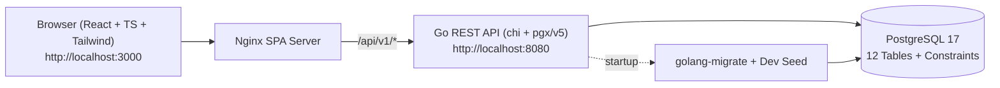

# 01 — Architecture & Technical Decisions (ADRs)

## 1. High-Level Architecture



---

## 2. Repository Structure

```text
BIS/
├── Attachments/                     # Project context & handoff documentation
├── backend/
│   ├── cmd/api/main.go              # Entrypoint: config -> pool -> migrate -> seed -> router
│   ├── internal/
│   │   ├── config/                  # Env configuration
│   │   ├── platform/
│   │   │   ├── db/                  # pgxpool (2s timeout), WithTx helper, golang-migrate
│   │   │   └── httpx/               # JSON helpers, APIError, 503 Unavailable detector, middleware
│   │   ├── auth/                    # Register, Login, Me, HS256 JWT, RequireAuth/RequireRole
│   │   ├── user/                    # User model & PostgreSQL repository
│   │   └── seed/                    # Idempotent dev seed (admin/admin + sample domain rows)
│   ├── migrations/                  # 000001_init_schema, 000002_seed_categories + embed.go
│   ├── Dockerfile
│   └── go.mod
├── frontend/
│   ├── src/
│   │   ├── api/                     # apiFetch (2.8s AbortController timeout -> 503 page), auth.ts
│   │   ├── auth/                    # AuthContext + RequireAuth / RequireRole route guards
│   │   ├── components/              # Layout, role-aware Navbar, DB status badge
│   │   ├── mocks/                   # Interactive domain state mirroring DB schema & business rules
│   │   ├── pages/
│   │   │   ├── public/              # Search, ExcursionDetails, Trips, TripDetails, Login, Register, 503
│   │   │   ├── tourist/             # Checkout (with Sold Out + alternatives), MyBookings, Profile
│   │   │   ├── provider/            # ProviderHub (Excursions, Slots, Participants, Trips, Agency)
│   │   │   └── admin/               # AdminConsole (Overview, Users, Agencies, Categories, Bookings)
│   │   ├── types/models.ts
│   │   └── utils/format.ts
│   ├── nginx.conf
│   ├── Dockerfile
│   └── package.json
├── docker-compose.yml
├── .env.example
└── Makefile
```

---

## 3. Architecture Decision Records (ADRs)

### ADR-001: Backend Stack — Go + `chi` + `pgx/v5` + Hand-Written SQL
- **Context:** We need explicit control over database transactions, row locking / atomic seat updates (`UPDATE ... WHERE booked_seats + $seats <= max_participants`), and fast connection timeouts (NFR-02, NFR-04).
- **Decision:** Use `go-chi/chi/v5` for routing, `jackc/pgx/v5/pgxpool` with hand-written parameterised SQL, and `golang-migrate/v4` with embedded SQL files (`iofs`).

### ADR-002: Money Stored as `BIGINT` Minor Units (`*_minor`)
- **Context:** Floating-point prices cause rounding bugs during refunds and multi-seat calculations.
- **Decision:** Store all monetary amounts as `BIGINT` in tiyn (`1 KZT = 100` minor units). Format to KZT (`₸`) in the frontend via `formatKZT(minor)`.

### ADR-003: Authentication & Seeded Admin (`admin` / `admin`)
- **Context:** Public visitors can register only as `tourist`, `guide`, or `agency_manager` (FR-04). The platform administrator account is provisioned by the system.
- **Decision:**
  - Public registration (`POST /api/v1/auth/register`) validates email format, phone (`^\+?[0-9]{10,15}$`), password (≥8 chars, ≥1 letter, ≥1 digit), and restricts `role` to `tourist | guide | agency_manager`.
  - In development mode (`APP_ENV=dev`), `internal/seed` creates the Admin user with login `admin` and password `admin` (hashed with bcrypt), plus sample `guide@tis.kz`, `manager@tis.kz`, and `tourist@tis.kz` accounts (`Passw0rd!`).
  - `POST /api/v1/auth/login` accepts either an email address or `admin` in the `email` field, verifies bcrypt, checks `is_blocked`, and returns a 24h HS256 JWT.

### ADR-004: Fast Availability Failure — 503 Service Unavailable Under 3 Seconds (NFR-02)
- **Context:** Lab04 NFR-02 requires displaying a "Service Unavailable" page within 3 seconds if the database connection fails.
- **Decision:**
  - `pgxpool` uses a 2-second connect timeout (`DB_TIMEOUT=2s`) and the HTTP router wraps requests in a 2.5s context timeout.
  - `httpx.IsUnavailable(err)` maps timeouts and PostgreSQL connection errors to HTTP `503 SERVICE_UNAVAILABLE`.
  - Frontend `apiFetch` uses a 2.8s `AbortController` timeout and redirects to `/unavailable` on HTTP 502/503/504 or network timeout.

### ADR-005: Interactive Frontend Store Ready for Incremental Backend Wiring
- **Context:** Milestone 1 delivers the full database, real registration/login, and complete UI/UX across all 4 roles.
- **Decision:** All role pages are implemented and interactive via `MockStoreContext.tsx` (which enforces FR-02 Sold Out + alternatives, BR-01 24-hour cancellation rule, FR-10/11 slot reschedule/cancel, FR-35 reviews, and FR-38..41 admin actions). Future backend phases replace individual store actions with REST API calls without rewriting UI components.
