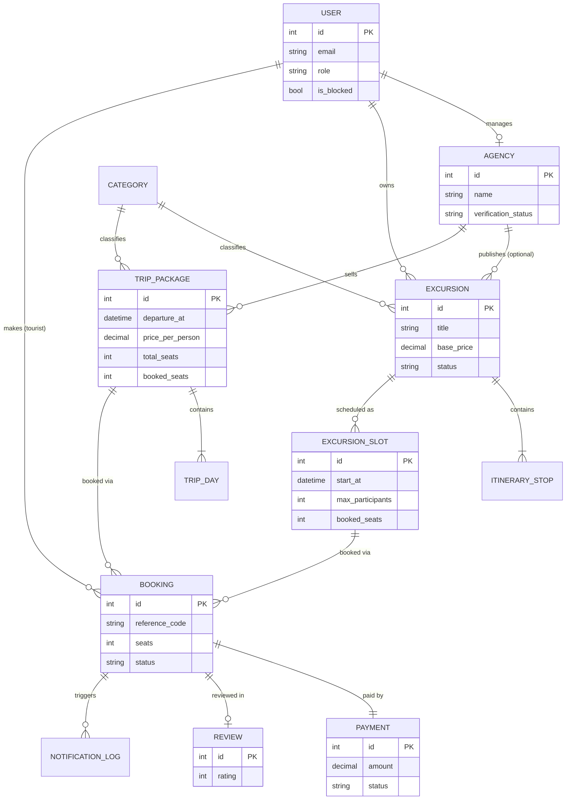

# Tourism IS — Plan Trips and Plan Excursions

**Project type:** Web-based information system (course project, KBTU)
**Team:** Inayat Rasul (23B030363), Yelnur Alga (23B031616), Duisenbay Olzhas (24B031737), Gulnaz Talapkyzy (25B031965), Bolat Askar (25B031178)
**Stack:** Go (backend REST API) · React (frontend SPA) · PostgreSQL (database) · Docker / Docker Compose (environment)

> This document describes **what the system is, what it does and how it is structured**. It deliberately does not describe UI design. Items marked **[Lab04]** come directly from the team's Lab04 requirements; items marked **[Extended]** were added to make the system complete and are decided with the team lead.

---

## 1. Purpose and Problem Statement

### 1.1 What the system is for
Tourism IS is a booking and scheduling platform where **independent tour guides** and **small local excursion agencies** publish excursions and multi-day trip packages, and **tourists** search, book and pay for them online.

### 1.2 The problem it solves [Lab04]
Local excursion providers currently update trip availability **by hand across several separate messaging channels**. This causes:
- last-minute **double-bookings** (more people booked than a guide can take),
- **manual scheduling delays**,
- no single reliable source of truth for availability, bookings and payments.

Tourism IS replaces this with one system that holds the single, authoritative seat count for every excursion slot and trip package, and **automatically refuses bookings that exceed capacity**.

### 1.3 Business need
| ID | Business need |
|----|---------------|
| BN-01 | Prevent overbooking and operational conflicts for local excursion providers. |
| BN-02 | Give providers one place to publish, schedule and manage excursions and trip packages. |
| BN-03 | Give tourists a fast, reliable way to find, book, pay for and cancel excursions and trips. |
| BN-04 | Keep tourists informed (confirmation, schedule changes, cancellation) through email. |
| BN-05 | Apply a clear, automatic cancellation and refund policy that protects providers from last-minute losses. |

### 1.4 Stakeholders
- **Primary (target):** independent tour guides and small local excursion agencies [Lab04].
- **Secondary:** tourists (customers) and the platform administrator.

---

## 2. Scope

### 2.1 In scope
- Registration, login and role-based access (4 roles).
- Provider tools: create, update, publish and schedule excursions; agencies additionally create trip packages.
- Search and browsing of excursions and trip packages.
- Booking with **automatic capacity enforcement**.
- **Simulated (mock) payment**, refunds and provider payout release inside the system.
- Cancellation with the **24-hour refund rule**.
- Email notifications (confirmation with reference code, schedule change, cancellation).
- Reviews and ratings after a completed trip.
- Basic administration (users, agency verification, categories).
- Graceful degradation: "Service Unavailable" page when the database is down.

### 2.2 Out of scope
- Real payment gateways and storing real card data.
- QR-code generation (explicitly dropped in Lab04 to keep the scope simple).
- Waitlist for sold-out slots.
- Agency–guide employment/membership (a guide is independent; an agency is managed by its manager).
- Admin moderation/reports module for reviews.
- Sub-bookings inside a trip package (hotel, transport booked separately).
- Mobile native apps, SMS, chat, multi-currency, multi-language content.

---

## 3. Actors and Roles

| Role | Who they are | Main capabilities |
|------|--------------|-------------------|
| **Tourist** | End customer | Search, book, pay (mock), view and cancel own bookings, leave reviews. |
| **Guide** | Independent tour guide | Manage own profile, create/publish own excursions and slots, view own bookings and participant lists, cancel/reschedule own slots. **Cannot** create trip packages. |
| **Agency Manager** | Representative of a small agency | Manage agency profile, create/publish agency excursions and slots, **create and publish trip packages**, view agency bookings. |
| **Admin** | Platform administrator | Manage users (block/unblock), verify agencies, manage categories, view all bookings and system overview. |
| **System** (non-human) | Scheduler and mail service | Sends emails, marks past bookings as completed. |

A user has **exactly one role**. Authentication uses email + password; authorization is enforced by role on every protected endpoint.

---

## 3A. Key Concepts (glossary)

| Term | Meaning |
|------|---------|
| **Excursion** | A single-trip activity template (title, description, itinerary stops, meeting point, base price, duration). Not directly bookable by itself. |
| **Excursion Slot** | A concrete scheduled occurrence of an excursion with **start time, price and maximum participants**. This is what tourists book. |
| **Trip Package** | A **multi-day** product sold by an agency: fixed dates, fixed price per person, fixed number of seats. Booked as a whole (no sub-bookings). |
| **Booking** | A tourist's reservation of N seats on one slot **or** one trip package. Has a unique **booking reference code**. |
| **Provider** | The owner of the offer: a Guide or an Agency (via its Manager). |
| **Departure time** | Slot start time, or trip package departure date-time. The 24-hour rule is measured against it. |

---

## 4. Functional Requirements

Requirements FR-01…FR-03 are from **Lab04**; the rest are **[Extended]** to complete the system.

### 4.1 Accounts and access
| ID | Requirement |
|----|-------------|
| FR-04 [Ext] | The system shall allow a visitor to register as Tourist, Guide or Agency Manager with email, password, full name and phone number. |
| FR-05 [Ext] | The system shall authenticate users by email and password and restrict every protected action by role. |
| FR-06 [Ext] | The system shall let a user view and edit their own profile (full name, phone) and change their password. |
| FR-07 [Ext] | The system shall let an Agency Manager create and edit an agency profile (name, description, contact, city), which is **pending until an Admin verifies it**; unverified agencies cannot publish. |

### 4.2 Excursion management (providers)
| ID                | Requirement                                                                                                                                                                                  |
| ----------------- | -------------------------------------------------------------------------------------------------------------------------------------------------------------------------------------------- |
| **FR-01 [Lab04]** | The system shall allow tour guides (and agency managers) to **create, update and publish custom excursion itineraries with designated start times, pricing and maximum participant limits**. |
| FR-08 [Ext]       | An excursion shall consist of: title, description, category, city, meeting point, duration, base price, ordered itinerary stops, status (`draft` / `published` / `archived`).                |
| FR-09 [Ext]       | A provider shall add one or many **slots** to an excursion, each with start time, price (defaults to base price) and **maximum participants**.                                               |
| FR-10 [Ext]       | A provider shall be able to **reschedule** a slot. All tourists holding active bookings on that slot shall be emailed the change (emergency itinerary update).                               |
| FR-11 [Ext]       | A provider shall be able to **cancel a slot**. All active bookings are cancelled with **100% refund** regardless of timing, and tourists are emailed.                                        |
| FR-12 [Ext]       | A slot's maximum participants cannot be reduced below its currently booked seats.                                                                                                            |
| FR-13 [Ext]       | A provider shall see the booking list and participant contacts (name, phone, email, special requests) for their own slots.                                                                   |
| FR-14 [Ext]       | Only the owner (guide, or manager of the owning agency) may edit or delete an excursion; a published excursion with active bookings may be archived but not deleted.                         |

### 4.3 Trip packages (agencies only)
| ID | Requirement |
|----|-------------|
| FR-15 [Ext] | A verified Agency Manager shall create, update and publish **trip packages**: title, description, destination, category, departure date-time, return date, **price per person**, **total seats**, included services (free text), day-by-day itinerary (descriptive text only), status. |
| FR-16 [Ext] | A trip package is booked as a whole; there are no sub-bookings. Seats are tracked exactly like slot capacity. |
| FR-17 [Ext] | A package's total seats cannot be reduced below its booked seats; a package with active bookings can be cancelled by the agency (100% refund to all) but not deleted. |

### 4.4 Search and browsing (tourists)
| ID | Requirement |
|----|-------------|
| FR-18 [Ext] | The system shall let anyone (even unauthenticated) browse and search **published** excursions and trip packages. |
| FR-19 [Ext] | Search shall support filters: keyword, city, category, date range, price range, minimum rating, provider; and sorting by date, price, rating. Results are paginated. |
| FR-20 [Ext] | Excursion details shall show itinerary, provider info, upcoming slots with **remaining seats**, price, and reviews. |

### 4.5 Booking
| ID | Requirement |
|----|-------------|
| **FR-02 [Lab04]** | The system shall **automatically reject** a booking request if the selected excursion slot has reached its maximum participant limit (or if the requested seats exceed remaining seats). |
| FR-21 [Ext] | On rejection due to capacity, the system shall return a **"Sold Out"** error and **suggest alternative available time slots for the same excursion** (Lab04 acceptance criterion). |
| FR-22 [Ext] | Checkout shall require **contact email and phone number (mandatory)**; **special request notes are optional** (Lab04 Part B decision). |
| FR-23 [Ext] | A tourist may book 1..N seats (N limited by remaining seats and a configurable per-booking maximum, default 10). |
| FR-24 [Ext] | Capacity checking and seat reservation shall be **atomic**, so two simultaneous requests can never exceed capacity. |
| FR-25 [Ext] | A booking is **not allowed** for slots/packages that have already started, are cancelled, or are not published. |
| **FR-03 [Lab04]** | The system shall send an **email with excursion details and a booking reference code** to the user after a booking is completed. |
| FR-26 [Ext] | Each booking shall have a **unique, human-readable reference code** (e.g. `TIS-8F3K2A`). |

### 4.6 Payment (simulated)
| ID | Requirement |
|----|-------------|
| FR-27 [Ext] | Payment is performed through an **internal mock payment service** that simulates a gateway: it returns success or failure and a fake transaction ID. **No real card data is stored.** |
| FR-28 [Ext] | A booking becomes `confirmed` only after a successful (mock) payment. If payment fails, the seats are released and no booking is confirmed. |
| FR-29 [Ext] | Payment records have states: `paid`, `refunded`, `released_to_provider`. |

### 4.7 Cancellation and refunds
| ID | Requirement |
|----|-------------|
| **BR-01 [Lab04]** | A tourist cancellation made **less than 24 hours** before the departure time is **non-refundable**, and **100% of the booking fee is released to the provider**. |
| FR-30 [Ext] | A tourist cancellation made **24 hours or more** before departure receives a **100% refund** (mock refund recorded in the payment). |
| FR-31 [Ext] | On any tourist cancellation the booked seats are **returned to availability**, even if the fee is non-refundable. |
| FR-32 [Ext] | Cancellation after departure time is not allowed. |
| FR-33 [Ext] | Cancellation by the **provider** (slot or package) always results in a 100% refund and an email to affected tourists. |
| FR-34 [Ext] | A cancellation confirmation email states whether the booking was refunded or non-refundable. |

### 4.8 Reviews and ratings
| ID | Requirement |
|----|-------------|
| FR-35 [Ext] | A tourist may leave **one review (rating 1–5 + optional comment)** per **completed** booking. |
| FR-36 [Ext] | The system shall show each excursion's and trip package's **average rating and review count**. |
| FR-37 [Ext] | A review can be edited by its author; it cannot be created for cancelled or not-yet-completed bookings. |

### 4.9 Administration
| ID | Requirement |
|----|-------------|
| FR-38 [Ext] | Admin shall list, search, block and unblock users. A blocked user cannot log in. |
| FR-39 [Ext] | Admin shall verify or reject agencies. |
| FR-40 [Ext] | Admin shall manage the category list (create, rename, deactivate). |
| FR-41 [Ext] | Admin shall view all bookings and payments and a simple overview (counts of users, active excursions, bookings, revenue released). |

### 4.10 Notifications (email only)
| Event | Recipient | Content |
|-------|-----------|---------|
| Booking confirmed [Lab04 FR-03] | Tourist | Excursion/trip details, date/time, seats, price, **booking reference code**. |
| Slot rescheduled | Tourists with active bookings | Old and new time, reference code. |
| Booking cancelled by tourist | Tourist | Refund or non-refundable notice (BR-01). |
| Slot/package cancelled by provider | Affected tourists | Cancellation notice, full refund. |
| New booking (optional) | Provider | New booking summary. |
| Email delivery is recorded in a notification log (status `sent` / `failed`). | | |

---

## 5. Non-Functional Requirements

| ID | Category | Requirement |
|----|----------|-------------|
| **NFR-01 [Lab04]** | Performance | The excursion **search page shall load completely in under 3 seconds** when accessed by a single user. |
| **NFR-02 [Lab04]** | Availability | If the database connection fails, the system shall display a **"Service Unavailable" page within 3 seconds** instead of hanging. |
| NFR-03 [Ext] | Security | Passwords hashed (bcrypt/argon2); JWT-based sessions; role checks on every protected endpoint; input validation; parameterised SQL only; CORS restricted. |
| NFR-04 [Ext] | Data integrity | Capacity can never be exceeded, even under concurrent requests (database-level guarantee, see §9). |
| NFR-05 [Ext] | Reliability | Email failure must not roll back a confirmed booking; failed emails are logged and retried. |
| NFR-06 [Ext] | Portability | The whole system starts with a single `docker compose up`. |
| NFR-07 [Ext] | Maintainability | Layered backend, versioned DB migrations, OpenAPI documentation of the REST API. |
| NFR-08 [Ext] | Time handling | All timestamps stored in UTC; displayed in the user's/provider's local time (default Asia/Almaty). The 24-hour rule is computed in UTC. |

---

## 6. Business Rules Summary

| ID | Rule |
|----|------|
| BR-01 | Tourist cancels **< 24 h** before departure → **non-refundable, 100% released to provider**. [Lab04] |
| BR-02 | Tourist cancels **≥ 24 h** before departure → **100% refund**. |
| BR-03 | Provider cancels a slot or trip package → **100% refund** always. |
| BR-04 | `booked_seats` must never exceed `max_participants` (slot) or `total_seats` (package). |
| BR-05 | Contact **email and phone are mandatory** at checkout; special requests are optional. [Lab04] |
| BR-06 | Only **published** items of **verified** providers can be booked. |
| BR-07 | No booking or cancellation after departure time. |
| BR-08 | One review per completed booking. |
| BR-09 | Only Agency Managers can create trip packages; only the owner can modify their offers. |
| BR-10 | Seats freed by cancellation immediately return to availability. |
| BR-11 | All prices are in one system currency (default **KZT**, configurable) and are non-negative; max participants ≥ 1. |

---

## 7. Data Model

### 7.1 Entities

| Entity | Key attributes |
|--------|----------------|
| **User** | id, email (unique), password_hash, full_name, phone, role (`tourist`/`guide`/`agency_manager`/`admin`), is_blocked, created_at |
| **Agency** | id, manager_user_id (FK, unique), name, description, city, contact_email, contact_phone, verification_status (`pending`/`verified`/`rejected`), created_at |
| **Category** | id, name (unique), is_active |
| **Excursion** | id, owner_user_id (FK User: guide or manager), agency_id (FK, nullable), category_id (FK), title, description, city, meeting_point, duration_minutes, base_price, status (`draft`/`published`/`archived`), created_at |
| **ItineraryStop** | id, excursion_id (FK), position, title, description, duration_minutes |
| **ExcursionSlot** | id, excursion_id (FK), start_at, price, max_participants, booked_seats, status (`open`/`cancelled`) |
| **TripPackage** | id, agency_id (FK), category_id (FK), title, description, destination, departure_at, return_at, price_per_person, total_seats, booked_seats, included_services, status (`draft`/`published`/`cancelled`/`archived`) |
| **TripDay** | id, trip_package_id (FK), day_number, title, description |
| **Booking** | id, reference_code (unique), tourist_id (FK User), excursion_slot_id (FK, nullable), trip_package_id (FK, nullable), seats, total_amount, contact_email, contact_phone, special_requests (nullable), status (`confirmed`/`cancelled_by_tourist`/`cancelled_by_provider`/`completed`), cancelled_at, created_at |
| **Payment** | id, booking_id (FK, unique), amount, method (`mock`), transaction_ref, status (`paid`/`refunded`/`released_to_provider`), refunded_amount, paid_at, updated_at |
| **Review** | id, booking_id (FK, unique), tourist_id (FK), excursion_id (FK, nullable), trip_package_id (FK, nullable), rating (1–5), comment, created_at |
| **NotificationLog** | id, booking_id (FK, nullable), recipient_email, type, status (`sent`/`failed`), attempts, created_at |

**Constraint on Booking:** exactly one of `excursion_slot_id` or `trip_package_id` must be non-null (`CHECK`).
**Constraints on capacity:** `CHECK (booked_seats >= 0 AND booked_seats <= max_participants)` on slots and `<= total_seats` on packages.

### 7.2 Relationships

| Relationship | Cardinality |
|--------------|-------------|
| Agency — User (manager) | 1 : 1 (a manager manages one agency) |
| User (guide/manager) — Excursion (owner) | 1 : N |
| Agency — Excursion | 1 : N (optional; guide excursions have no agency) |
| Agency — TripPackage | 1 : N |
| Category — Excursion / TripPackage | 1 : N |
| Excursion — ItineraryStop | 1 : N (ordered) |
| Excursion — ExcursionSlot | 1 : N |
| TripPackage — TripDay | 1 : N (ordered) |
| User (tourist) — Booking | 1 : N |
| ExcursionSlot — Booking | 1 : N |
| TripPackage — Booking | 1 : N |
| Booking — Payment | 1 : 1 |
| Booking — Review | 1 : 0..1 |
| Booking — NotificationLog | 1 : N |

### 7.3 ER diagram



---

## 8. State Models

**Booking**
```
(new) --payment ok--> confirmed --provider/tourist cancel--> cancelled_by_tourist | cancelled_by_provider
                         \--departure passed--> completed
(new) --payment fails--> (no booking, seats released)
```

**Payment**
```
paid --tourist cancel ≥24h or provider cancel--> refunded
paid --tourist cancel <24h--> released_to_provider
paid --trip completed--> released_to_provider
```

**Excursion / Trip Package:** `draft → published → archived` (package may also be `cancelled`).
**Slot:** `open → cancelled`.

---

## 9. Core Logic and Guidelines

### 9.1 Overbooking prevention (FR-02, FR-24, NFR-04)
Capacity must be enforced **inside the database transaction**, not only in code. Recommended approach:

1. Begin transaction.
2. Atomic seat reservation:
   ```sql
   UPDATE excursion_slots
      SET booked_seats = booked_seats + $seats
    WHERE id = $slot_id
      AND status = 'open'
      AND start_at > now()
      AND booked_seats + $seats <= max_participants;
   ```
3. If **0 rows affected** → rollback, return **HTTP 409 "Sold Out"** plus a list of alternative slots of the same excursion (future, `open`, enough remaining seats).
4. Create booking (`pending`), run mock payment, mark `confirmed`, commit. If payment fails → rollback (seats released automatically).
5. After commit, enqueue the confirmation email (FR-03).

The `CHECK` constraint on `booked_seats` is the last line of defence. The same logic applies to `trip_packages.total_seats`.

### 9.2 Cancellation algorithm (BR-01, FR-30…FR-33)
```
if booking.status != confirmed         -> reject
if now >= departure_at                 -> reject (BR-07)
begin tx
  free seats (booked_seats -= seats)           // BR-10
  if departure_at - now >= 24h:  payment.status = refunded               // 100% refund
  else:                          payment.status = released_to_provider   // BR-01
  booking.status = cancelled_by_tourist
commit
send cancellation email
```
Provider cancellation: refund all active bookings (100%), set `cancelled_by_provider`, email everyone.

### 9.3 Booking reference code
Short random uppercase alphanumeric code with prefix (e.g. `TIS-` + 6 chars), generated server-side, unique index, regenerate on collision.

### 9.4 Mock payment service
Internal Go interface `PaymentGateway { Charge(), Refund() }` with a **mock implementation** that returns success by default and failure for a designated test value (e.g. a test "card" token such as `fail`). Because it is behind an interface, a real gateway can replace it later without changing booking logic. Never store card numbers.

### 9.5 Availability failure (NFR-02)
- Database connection and query timeouts around **2 seconds**.
- Health endpoint `GET /api/health` checks the DB.
- On DB error the API returns **HTTP 503** with a stable error code (`SERVICE_UNAVAILABLE`); the React app shows the **"Service Unavailable" page** (also on network timeout of the API at ≤ 3 s total).

### 9.6 Search performance (NFR-01)
Indexes on `excursion_slots(start_at)`, `excursions(city, category_id, status)`, `trip_packages(departure_at, status)`, `bookings(tourist_id)`, `bookings(excursion_slot_id)`. Server-side pagination (default 12–20 items). Average rating stored/aggregated efficiently (materialised column or aggregate query on indexed FK).

### 9.7 Background jobs (inside the Go service)
- **Completion job** (periodic, e.g. every 5–10 min): mark `confirmed` bookings whose departure/end has passed as `completed`, and release payment to the provider.
- **Email retry job**: retry `failed` notifications a limited number of times.

---

## 10. Use Cases

Actors: **T** Tourist, **G** Guide, **M** Agency Manager, **A** Admin, **S** System.

### 10.1 Use case list

| ID | Use case | Actor | Req. |
|----|----------|-------|------|
| UC-01 | Register account | Visitor | FR-04 |
| UC-02 | Log in / log out | T, G, M, A | FR-05 |
| UC-03 | Edit profile | T, G, M | FR-06 |
| UC-04 | Create and verify agency profile | M, A | FR-07, FR-39 |
| UC-05 | Create excursion (draft) with itinerary | G, M | FR-01, FR-08 |
| UC-06 | Publish / archive excursion | G, M | FR-01, FR-14 |
| UC-07 | Add / edit slot (time, price, capacity) | G, M | FR-09, FR-12 |
| UC-08 | Reschedule slot | G, M | FR-10 |
| UC-09 | Cancel slot | G, M | FR-11, FR-33 |
| UC-10 | View bookings and participants | G, M | FR-13 |
| UC-11 | Create and publish trip package | M | FR-15…FR-17 |
| UC-12 | Search and filter offers | T / Visitor | FR-18, FR-19 |
| UC-13 | View excursion / trip details | T / Visitor | FR-20 |
| UC-14 | Book excursion slot | T | FR-02, FR-22…FR-28 |
| UC-15 | Handle sold-out slot | T, S | FR-02, FR-21 |
| UC-16 | Book trip package | T | FR-16, FR-22…FR-28 |
| UC-17 | View my bookings | T | FR-26 |
| UC-18 | Cancel booking | T | BR-01, FR-30…FR-32 |
| UC-19 | Leave / edit review | T | FR-35…FR-37 |
| UC-20 | Manage users | A | FR-38 |
| UC-21 | Manage categories | A | FR-40 |
| UC-22 | View all bookings and overview | A | FR-41 |
| UC-23 | Send email notification | S | FR-03, §4.10 |
| UC-24 | Complete past bookings | S | §9.7 |
| UC-25 | Show "Service Unavailable" | S | NFR-02 |

### 10.2 Detailed key use cases

#### UC-05 / UC-07 — Create excursion and slots (FR-01)
- **Actor:** Guide or Agency Manager (verified agency for managers).
- **Precondition:** Logged in as provider; not blocked.
- **Main flow:** 1) Provider enters excursion data and itinerary stops. 2) System saves as `draft`. 3) Provider adds slots with start time, price and max participants. 4) Provider publishes; excursion becomes visible in search.
- **Alternative:** Invalid data (price < 0, capacity < 1, start time in the past) → validation error. Unverified agency → publishing refused.
- **Postcondition:** Published excursion with ≥1 open slot is searchable.

#### UC-14 — Book excursion slot (FR-02, FR-03, FR-22…FR-28)
- **Actor:** Tourist. **Precondition:** Logged in; slot is open, in the future, excursion published.
- **Main flow:** 1) Tourist selects slot and number of seats. 2) Tourist enters mandatory contact email and phone, optional special requests. 3) System atomically reserves seats (§9.1). 4) Tourist pays through the mock payment. 5) System confirms the booking and generates the reference code. 6) System sends confirmation email with details and reference code.
- **Alternatives:** (a) Not enough seats → UC-15. (b) Payment fails → seats released, booking not created, error shown. (c) Email fails → booking stays confirmed, email retried (NFR-05).
- **Postcondition:** Booking `confirmed`, payment `paid`, `booked_seats` increased.

#### UC-15 — Sold-out slot (Lab04 acceptance criterion, FR-02/FR-21)
- **Given** a slot with max capacity 10 and 10 confirmed seats, **when** a user tries to reserve 1 seat, **then** the system rejects the booking, shows a **"Sold Out"** error and **suggests alternative available time slots for the same excursion**.
- If no alternative slots exist, the message states that no other slots are currently available.

#### UC-16 — Book trip package
Same as UC-14, but against `trip_packages.total_seats`; confirmation email contains departure/return dates and included services.

#### UC-18 — Cancel booking (BR-01)
- **Actor:** Tourist. **Precondition:** Booking `confirmed`, departure not yet passed.
- **Main flow:** 1) Tourist chooses cancel. 2) System calculates time to departure. 3a) **≥ 24 h:** 100% refund, payment `refunded`. 3b) **< 24 h:** system warns "non-refundable"; on confirmation, payment `released_to_provider`. 4) Seats are returned to availability. 5) Cancellation email sent.
- **Alternative:** Booking already cancelled or departure passed → rejected.

#### UC-08 — Reschedule slot
Provider changes start time of a slot with active bookings → system updates slot and emails every affected tourist with old/new time and reference code.

#### UC-09 — Cancel slot (provider)
Provider cancels slot → slot `cancelled`, all active bookings `cancelled_by_provider`, 100% refund, emails sent.

#### UC-19 — Review
Tourist opens a `completed` booking → submits rating 1–5 and optional comment → system stores one review per booking and updates the offer's average rating.

#### UC-25 — Database failure
DB connection fails → API returns 503 within the timeout → frontend shows the "Service Unavailable" page within 3 s.

---

## 11. Requirements Traceability Matrix (extended)

| Business need | Requirement | Description (short) | Source | Test case (example) |
|---------------|-------------|---------------------|--------|---------------------|
| BN-01 | FR-02 | Reject booking when slot is full | Lab04 | TC-EX-02 (Pass) |
| BN-01 | FR-21, FR-24 | Sold-out message with alternatives; atomic seat reservation | Ext | TC-EX-03, TC-EX-04 |
| BN-02 | FR-01 | Create/update/publish itineraries with time, price, capacity | Lab04 | TC-EX-01 |
| BN-02 | FR-09…FR-17 | Slots, rescheduling, trip packages | Ext | TC-EX-05… |
| BN-03 | FR-18…FR-20, FR-23, FR-27, FR-28 | Search, booking, mock payment | Ext | TC-BK-xx |
| BN-04 | FR-03 | Confirmation email with reference code | Lab04 | TC-EX-06 |
| BN-04 | FR-10, FR-33, FR-34 | Change and cancellation emails | Ext | TC-NT-xx |
| BN-05 | BR-01 | < 24 h cancellation non-refundable | Lab04 | TC-CN-01 |
| BN-05 | FR-30, FR-31 | ≥ 24 h full refund, seats returned | Ext | TC-CN-02 |
| — | NFR-01 | Search < 3 s | Lab04 | TC-PF-01 |
| — | NFR-02 | Service Unavailable < 3 s | Lab04 | TC-AV-01 |

*(Test case IDs other than TC-EX-02 are suggestions for the team to define.)*

---

## 12. Technical Architecture and Guideline

### 12.1 High-level architecture
```
 Browser (React SPA)  ──HTTPS/JSON──▶  Go REST API  ──SQL──▶  PostgreSQL
                                          │
                                          └── SMTP ──▶ Mail server (Mailpit in dev)
```
Docker Compose services: `frontend`, `backend`, `db` (PostgreSQL), `mailpit` (dev email catcher), optional `migrate` (runs DB migrations on start).

### 12.2 Backend (Go)
- **Style:** REST API under `/api/v1`, JSON, JWT bearer authentication, role-based middleware.
- **Suggested layers:** `handler` (HTTP) → `service` (business rules) → `repository` (SQL) → PostgreSQL.
- **Suggested libraries (free choice):** `chi` or `gin` (router), `pgx` (PostgreSQL driver), `golang-migrate` (migrations), `golang-jwt`, `bcrypt`, `net/smtp` or a mail library, `swaggo`/OpenAPI for docs.
- **Suggested layout:**
  ```
  backend/
    cmd/api/main.go
    internal/
      config/  auth/  user/  agency/  excursion/  trip/
      booking/  payment/  review/  notification/  admin/
      platform/ (db, http, mail, jobs)
    migrations/
  ```
- Configuration through environment variables (DB URL, JWT secret, SMTP, currency, timeouts).

### 12.3 API groups

| Group | Main endpoints (examples) | Access |
|-------|---------------------------|--------|
| Auth | `POST /auth/register`, `POST /auth/login`, `GET /auth/me` | Public / any |
| Profile | `GET/PUT /me` | Authenticated |
| Agencies | `POST/PUT /agencies`, `GET /agencies/{id}` | Manager; public read |
| Excursions | `GET /excursions` (search), `GET /excursions/{id}`, `POST/PUT /excursions`, `POST /excursions/{id}/publish` | Public read; Guide/Manager write |
| Slots | `POST /excursions/{id}/slots`, `PUT /slots/{id}`, `POST /slots/{id}/cancel` | Owner |
| Trip packages | `GET /trips`, `GET /trips/{id}`, `POST/PUT /trips`, `POST /trips/{id}/cancel` | Public read; Manager write |
| Bookings | `POST /bookings`, `GET /bookings/me`, `POST /bookings/{id}/cancel`, `GET /provider/bookings` | Tourist / Provider |
| Payments | internal to booking flow; `GET /bookings/{id}/payment` | Tourist (own) |
| Reviews | `POST /bookings/{id}/review`, `PUT /reviews/{id}`, `GET /excursions/{id}/reviews` | Tourist / public read |
| Admin | `GET /admin/users`, `POST /admin/users/{id}/block`, `POST /admin/agencies/{id}/verify`, `CRUD /admin/categories`, `GET /admin/overview` | Admin |
| System | `GET /health` | Public |

Error format: `{ "code": "SOLD_OUT", "message": "...", "alternatives": [ ... ] }`. Standard codes: `VALIDATION_ERROR` (400), `UNAUTHORIZED` (401), `FORBIDDEN` (403), `NOT_FOUND` (404), `SOLD_OUT` / `CONFLICT` (409), `SERVICE_UNAVAILABLE` (503).

### 12.4 Frontend (React) — functional responsibility only
- Pages grouped by role: public (search, details, login/register), tourist (checkout, my bookings, reviews), provider (my excursions, slots, bookings, trip packages), admin.
- Route guards by role; API client with JWT handling and a global error handler that shows the **Service Unavailable** page on 503/timeouts.
- Form validation mirrors backend rules (mandatory contact email and phone at checkout).

### 12.5 Database (PostgreSQL)
- Migrations versioned in the repository; seed data for roles-test users, categories and sample excursions.
- Use transactions for booking, cancellation, slot cancellation.
- Enforce rules in the DB where possible: `UNIQUE` (email, reference_code, one payment and one review per booking), `CHECK` (capacity, rating 1–5, booking target), foreign keys, indexes from §9.6.

### 12.6 Docker
- One `Dockerfile` per service (multi-stage Go build; Node build then static serving for React).
- `docker-compose.yml`: `db` with a named volume and healthcheck, `backend` waits for `db`, `frontend` served on its own port, `mailpit` for viewing confirmation emails.
- `.env.example` with all variables; secrets never committed.

### 12.7 Testing guideline
- **Unit:** refund rule (23h59m vs 24h00m), reference code uniqueness, capacity calculation.
- **Integration:** concurrent booking of the last seat (two parallel requests → exactly one succeeds), payment failure rollback, role access control.
- **Acceptance:** Lab04 scenario — capacity 10, 10 confirmed, new booking → "Sold Out" + alternative slots.
- **Non-functional:** search page under 3 s; DB stopped → "Service Unavailable" within 3 s.

### 12.8 Suggested development order
1. Docker Compose + DB schema + migrations.
2. Auth and roles.
3. Excursions, itinerary stops, slots (FR-01).
4. Search and details.
5. Booking with atomic capacity check and Sold-Out handling (FR-02).
6. Mock payment, reference code and confirmation email (FR-03).
7. Cancellation and refund rules (BR-01).
8. Trip packages.
9. Reviews and ratings.
10. Admin functions, completion job, Service Unavailable handling (NFR-02), performance tuning (NFR-01).

---

## 13. Assumptions

These were decided by the project owner or assumed to complete the description; confirm or change them if needed:

1. Registration is required to book (no guest checkout).
2. Guides are independent; only agencies sell trip packages.
3. A tourist cancellation always returns the seats to availability, even when the fee is non-refundable.
4. Provider cancellations always refund 100%.
5. Payment is released to the provider when a booking is completed or when a tourist cancels within 24 hours.
6. One system currency (default KZT); one time zone default (Asia/Almaty), stored in UTC.
7. Excursions, slots and trips are bookable only until their start time.
8. An unverified agency can prepare drafts but cannot publish.
